# Adsbooster.net — Create it. Connect it. Publish it. Advertise it.

<p align="center">
  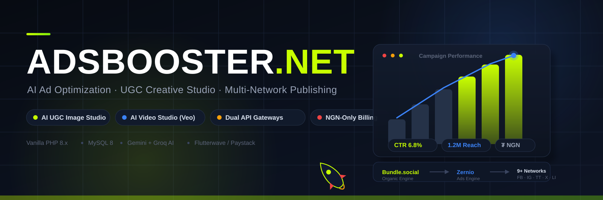
</p>

[](https://php.net)
[](https://mysql.com)
[](#)

---

## About the project

**Adsbooster.net** is a complete, self-hosted marketing platform. Everything a business
or freelancer needs to grow online lives in one place:

1. **Make the content** — AI studios generate photorealistic product photos and videos
   of people holding your product (no camera, no models), write the ad copy, and let
   you edit everything in the browser.
2. **Connect the accounts** — your social networks and ad accounts are linked through
   two professional connection gateways. You click "connect", sign in at the network's
   own website, and come back. **No passwords or secret keys are ever stored on your
   server** — only the connection itself.
3. **Publish everywhere** — write a post once and send it to Facebook, Instagram,
   TikTok, X, LinkedIn and Pinterest immediately or at a scheduled date and time.
4. **Run the ads** — turn the same creative into paid ads on Meta, TikTok, Google,
   LinkedIn, Pinterest and Reddit with a daily budget, an audience and a goal. Pause,
   resume or scale any campaign with one click.
5. **Let the background worker do the waiting** — a scheduled task sends posts at
   their exact time, launches queued ads, pulls real results back into your dashboard
   and emails reminders before every scheduled post.

Everything runs on plain PHP and MySQL — no frameworks, no build tools, no Node.js.
Upload the files, create a database, open the website in a browser: the platform
installs itself.

---

## How it works (the big picture)

<p align="center">
  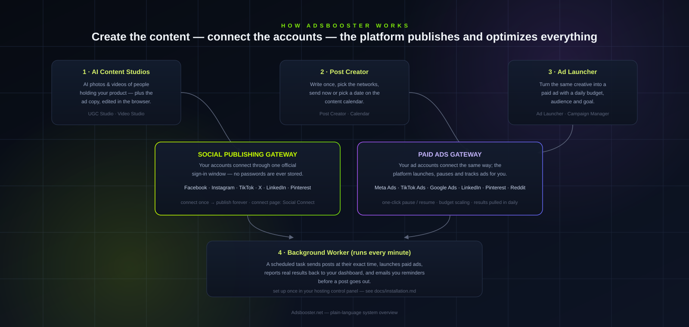
</p>

The only thing that must be set up **outside** the website itself is the scheduled
background task ("cron job") described in the installation guide — without it, posts
wait but never actually go out and queued ads never launch.

---

## Every feature, in plain words

### The AI studios — make the content

| Feature | What it does for you |
|---|---|
| **UGC Photo Studio** | Generates photorealistic images of everyday people holding, unboxing or using your product. Pick a creator personality (Gen-Z creator, fitness athlete, homemaker…), a shooting style (selfie hold, kitchen scene, flat lay…) and a size (square for feeds, vertical for Reels/TikTok, wide for banners). Includes a built-in editor with filters, badges like "BEST SELLER" and headline text. One click saves the image or sends it straight into the Post Creator. |
| **AI Video Studio** | Turns a short script into a real MP4 video: AI-painted scenes, camera zoom, bouncing captions, a music beat and a voice-over. Edit any video later, regenerate the scenes with a fresh look, download it, run it as an ad, or post it — all from one library. A completely **free route needs no API key at all**, so videos work out of the box. |

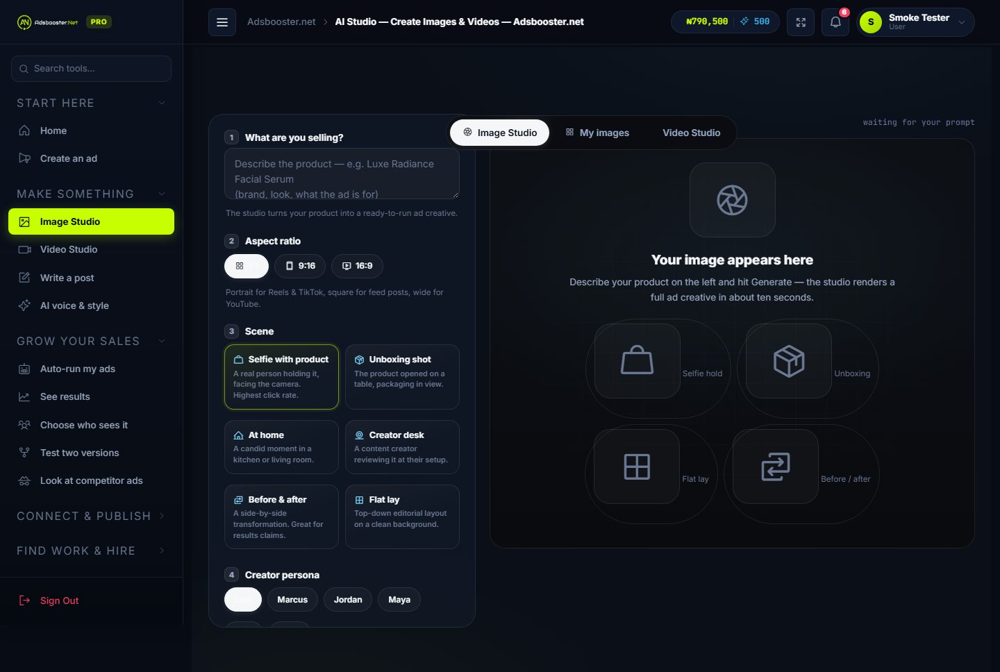
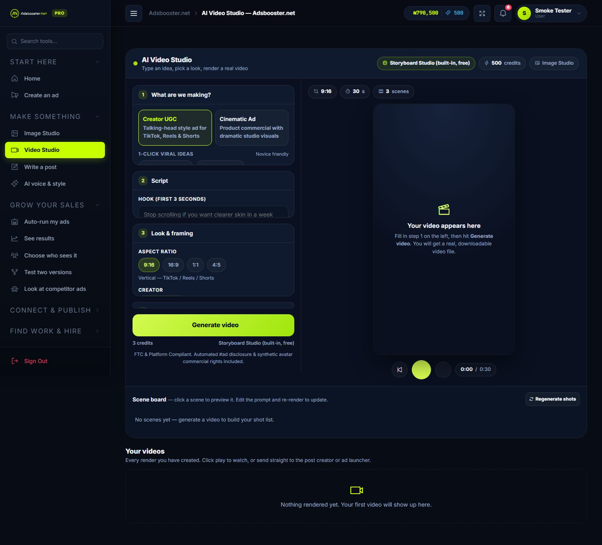

### The publishing engine — post everywhere without logging into anything

| Feature | What it does for you |
|---|---|
| **Social Connect** | One page shows every network. Click "connect", sign in at Facebook/TikTok/X/LinkedIn/Pinterest on **their** website, come back — the connection is verified and stored. Disconnect anytime. |
| **Post Creator** | A studio to write the text, attach photos or videos from the AI studios, preview it, and send it now or later to any connected network at once. |
| **Content Calendar** | A month view of every planned post. Drag a post to another day, attach notes to any day, and choose how many email reminders you want before the post goes out (up to five, timed from 7 days to 15 minutes before). |
| **Comments & results** | Read and reply to comments from inside the platform, and see likes, views and reach for every published post. |

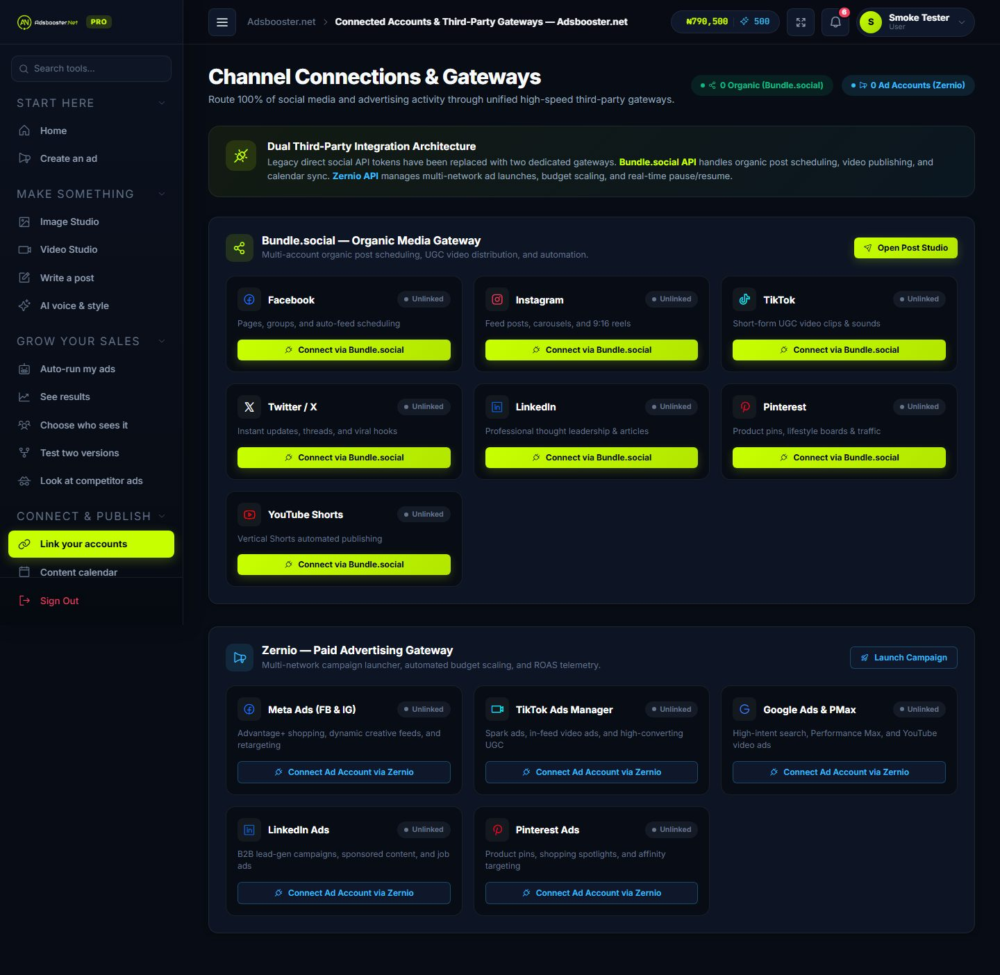
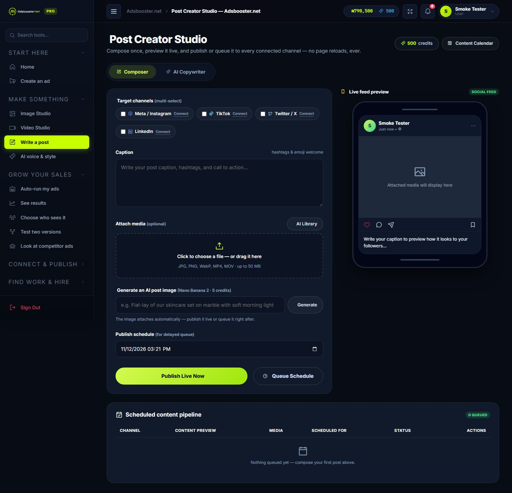
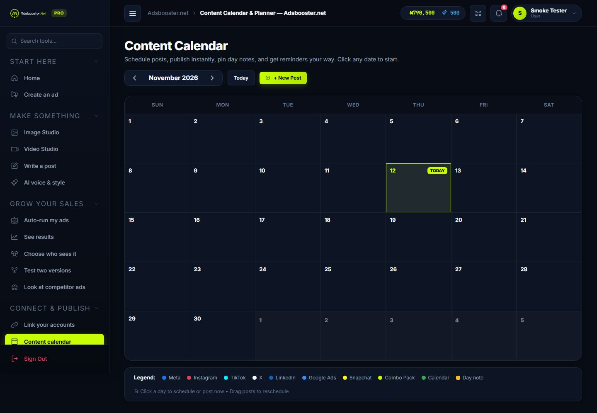

### The ads engine — paid campaigns without touching an ad manager

| Feature | What it does for you |
|---|---|
| **Ad Launcher** | Pick your connected ad account, choose the goal (traffic, engagement, awareness…), set a daily budget, write the headline and text, choose the audience age/countries/interests, and launch. The platform translates everything correctly for each network. |
| **Campaign Manager** | Every campaign on one screen with one-click **pause / resume** (live on the network), budget scaling, and real spend/result numbers pulled in automatically every hour. |
| **Competitor Ad Spy** | See the ads competitors run, and reverse-engineer what works. |
| **Audience Builder** | Build detailed audience groups (age, location, interests) and AI "lookalike" audiences from your best customers. |
| **A/B Test Studio** | Run two versions of a creative against each other; the platform declares the winner and moves the budget to it automatically. |
| **Anti-burn Auto-Pilot** | Safety rules that watch your spend: if a campaign burns money without results, it is paused automatically. |
| **Store Import** | Paste your Shopify or WooCommerce store address and the platform imports products and builds ready-to-run campaign packs. |

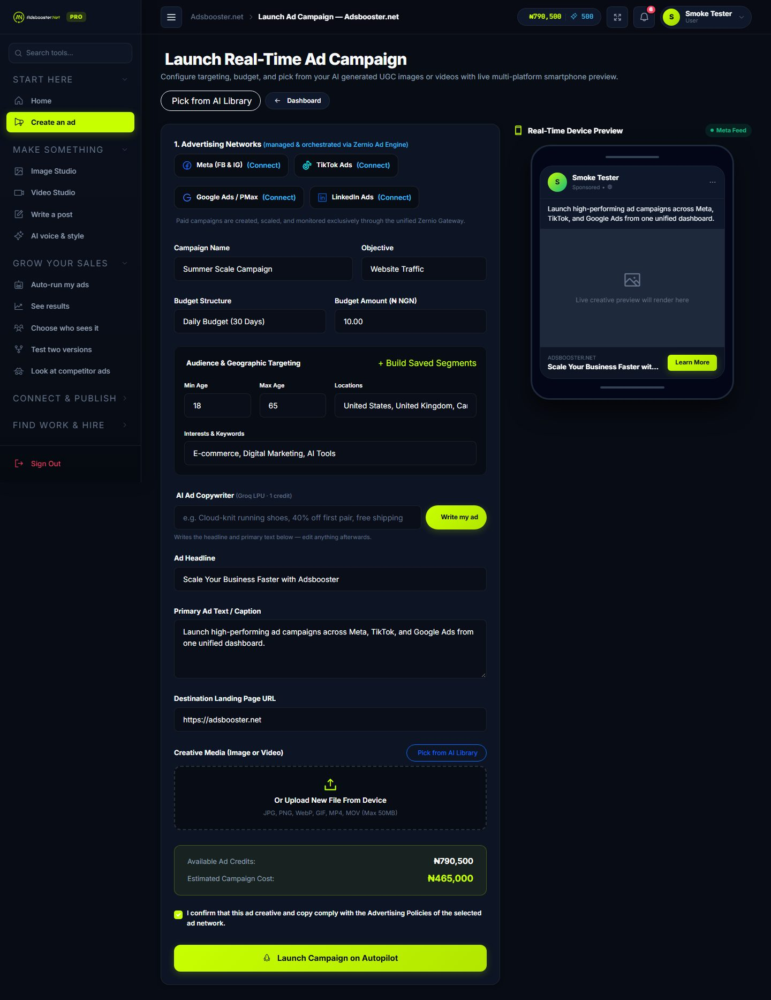

### The growth toolbox — get seen and get clients

| Feature | What it does for you |
|---|---|
| **Public Portfolio** | Every member gets a shareable public page (with a QR code) showing their work, services, prices and case studies — with four luxury design themes and an AI resume importer (drop in a PDF and the page fills itself). |
| **Business Directory** | A verified directory of businesses and products with direct WhatsApp / call buttons for buyers. |
| **Talent Marketplace** | Post or find jobs, contracts and bounties for media buyers, creators and copywriters. |
| **P2P Chat & Deals** | Chat directly with clients or freelancers, and propose structured deals with an agreed amount and milestones. |
| **Referral Programme** | Every member gets a personal invite link. When a referred person pays for a plan or credits, the referrer is rewarded **automatically** — with full admin control. |
| **Reviews** | Members review the platform; the best verified reviews are showcased on the homepage. |

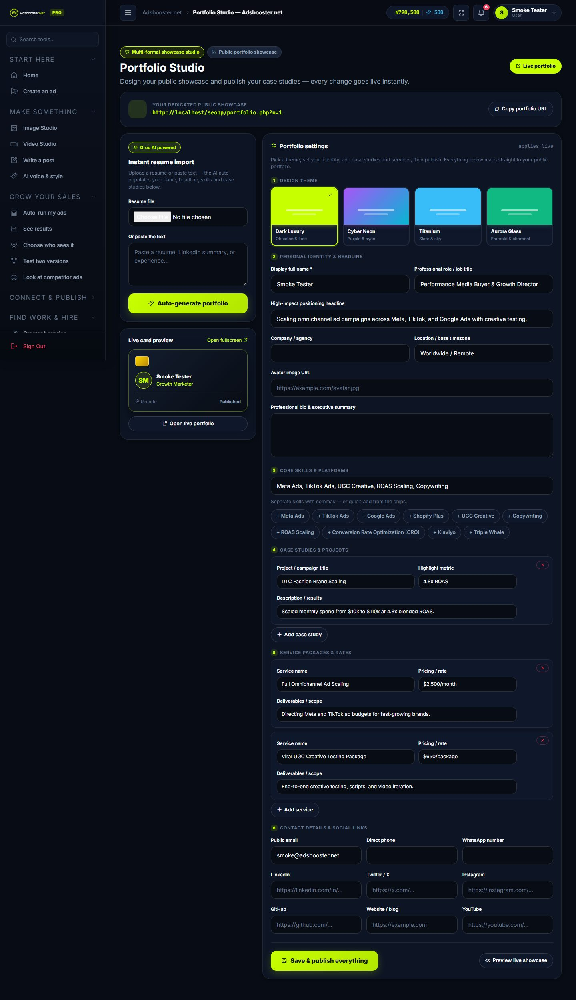
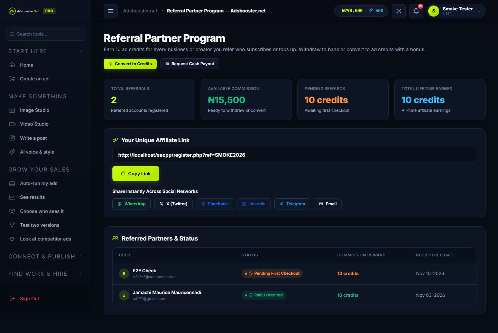

### The business side — plans, payments and safety

| Feature | What it does for you |
|---|---|
| **Plans & Credits** | Subscriptions and ad/AI credit packs. Payments run through **Paystack** and **Flutterwave**; every payment is verified with the gateway before anything is credited. |
| **Billing & Invoices** | Members see their wallet, history and PDF invoices. |
| **Two-Factor Login** | Standard authenticator-app codes, email codes as fallback, and 8 one-time recovery codes. Admins always must pass the second step. |
| **Developer API & Webhooks** | One master key lets other tools talk to the platform, with ready-made SDKs, a rate limit and signed webhooks. |
| **Admin Control Suite** | 25+ admin pages: users (with "view as user"), pricing, campaign inspection, transactions with webhook URLs, referrals, fraud watch, support tickets, SEO, translations, system health and more. |

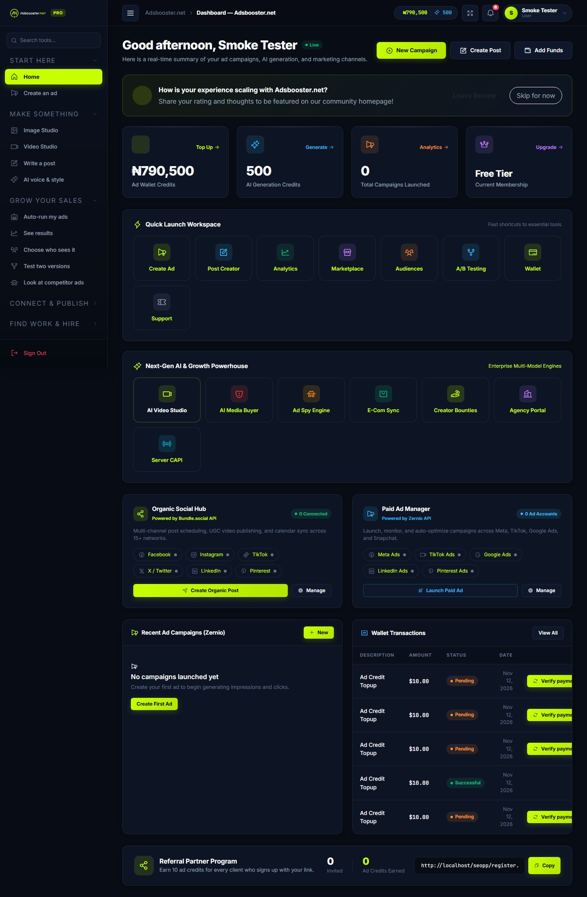
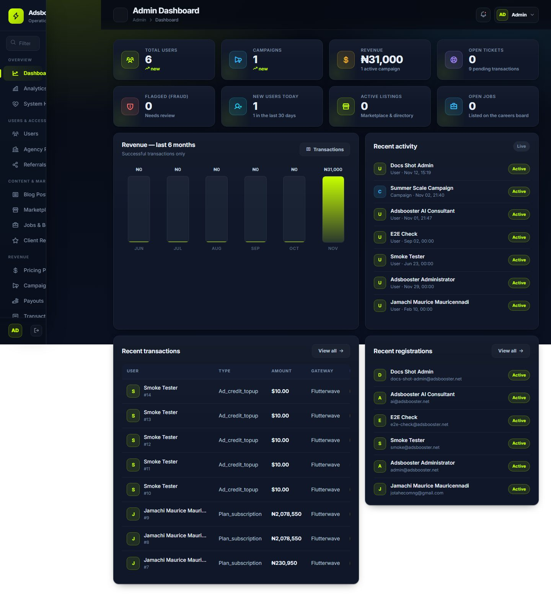

> The complete library of **58 page captures** — public, member and admin — lives in
> [`docs/screenshots/`](docs/screenshots/).

---

## Project structure — what lives where

No programming knowledge needed to read this: each folder is described by what it
*holds*, not how it is coded.

```
adsbooster/
│
├── index.php, login.php, register.php, pricing.php   ← the public website pages
│
├── dashboard.php, post-creator.php, calendar.php,    ← the member pages
│   create-ad.php, social-connect.php, portfolio.php
│
├── admin/                     ← the admin control suite (25+ management pages)
│
├── includes/                  ← shared page pieces (header, footer, popups)
│
├── modules/                   ← the "brain": one file per ability
│   ├── the two connection gateways (social + ads)
│   ├── the publishing engine and the background job queue
│   ├── the AI studios (photos, video, text)
│   ├── payments, referrals, emails and two-factor login
│   └── audience builder, A/B tests, auto-pilot, store import
│
├── cron/                      ← background tasks for the hosting scheduler
│   ├── queue_worker.php       ← THE IMPORTANT ONE: sends posts & launches ads
│   ├── publish_scheduled_posts.php, campaign_doctor.php,
│   ├── auto_refill_check.php, auto_buyer_daemon.php,
│   └── pull_campaign_metrics.php, ab_test_winner.php
│
├── api/                       ← for outside tools connecting to the platform
├── sdk/                       ← ready-made client libraries for developers
│
├── config/                    ← settings files (database access, keys)
├── database/                  ← the database installer & repair files
│
├── assets/                    ← styles, fonts, icons, scripts (the look)
│
├── uploads/                   ← everything users create (images, videos, avatars)
│
└── docs/                      ← you are here
    ├── features.md            ← every feature, step by step, with screenshots
    ├── installation.md        ← the step-by-step install guide (local & cPanel)
    ├── payments-webhooks.md   ← payment verification & webhook setup
    ├── referrals.md           ← the referral programme
    ├── screenshots/           ← captures of 58 pages
    └── assets/                ← diagrams & illustrations
```

**The wireframe in one sentence:** public pages pull people in → members create
content in the studios and connect accounts on the connect page → the calendar and
post creator schedule the work → the background worker executes it through the two
connection gateways → results and money flow back to the dashboard → admins watch
over everything from the admin suite.

---

## Installation — step by step

> The complete guide with every detail, troubleshooting and the cPanel setup lives in
> **[docs/installation.md](docs/installation.md)**. This is the short version.

### What you need

- A computer (local) or a hosting account (live) with **PHP 8.3 or newer** and
  **MySQL 8 / MariaDB**
- The project files (clone or download this repository)

### Local installation (Windows — Laragon or XAMPP)

1. **Put the files in your web folder** — e.g. `C:\laragon\www\adsbooster`
   (Laragon) or `C:\xampp\htdocs\adsbooster` (XAMPP).
2. **Start Apache and MySQL** from the Laragon / XAMPP control panel.
3. **Create an empty database** named `adsbooster` — open
   `http://localhost/phpmyadmin`, click *New*, type the name, click *Create*.
4. **Open the website** — `http://localhost/adsbooster`. On the first page load the
   platform **creates all its own tables automatically**. That's it — no SQL to run,
   nothing to edit.
5. **Create your account** through the normal register page. To make yourself the
   administrator, open phpMyAdmin → database `adsbooster` → table `users` → your
   row → set `role` to `admin`.
6. **Open the site and sign in** — `http://localhost/adsbooster/login`.

### Going live on cPanel hosting

1. Upload all project files into `public_html`.
2. Create a database + user in cPanel → *MySQL Databases*, and grant the user
   **all privileges**.
3. Visit your domain — the self-installer builds the schema. If your database name,
   user or password differs from the defaults, create `config/db.local.php`
   (there is an example inside `docs/installation.md`).
4. **Add the cron job** (cPanel → *Cron Jobs*) — this is what actually sends posts
   and launches ads:

   ```
   /usr/local/bin/ea-php83/root/usr/bin/php /home/YOURUSER/public_html/cron/queue_worker.php --once >> /home/YOURUSER/public_html/crons/queue_worker.log 2>&1
   ```
   scheduled **once per minute**. (First create the `crons` folder in File Manager.)
   The other cron tasks and their schedules are listed in `docs/installation.md`.

### Connecting the accounts (the 10-minute checklist)

1. **Social networks (posting):** Admin → Settings → paste the two gateway keys
   (Bundle.social and Zernio). Then each user opens **Social Connect**, clicks a
   network, signs in at the network's own site, and returns — the connection is
   verified before it is stored.
2. **Ad accounts (paid ads):** same page, "Google Ads" and other ad networks connect
   through the Zernio gateway the same way.
3. **Payments (Paystack / Flutterwave):** paste the API keys in Admin → Settings,
   then paste the webhook URLs shown in Admin → Transactions into each gateway's
   dashboard. Full details: [`docs/payments-webhooks.md`](docs/payments-webhooks.md).
4. **AI studios (optional):** a Gemini key upgrades photos/videos to the premium
   engines and a Groq key upgrades the copywriting — but both studios already work
   for free without any key.

---

## Documentation index

| Document | What's inside |
|---|---|
| **[docs/installation.md](docs/installation.md)** | The complete step-by-step install: local (Laragon/XAMPP), cPanel live hosting, cron jobs, troubleshooting |
| **[docs/features.md](docs/features.md)** | Every feature broken down in plain language, with screenshots and usage steps |
| **[docs/payments-webhooks.md](docs/payments-webhooks.md)** | Payment verification, webhook URLs and security |
| **[docs/referrals.md](docs/referrals.md)** | The referral programme, automatic rewards and admin controls |
| **[docs/screenshots/](docs/screenshots/)** | Captures of all 58 pages |
| **[DEPLOYMENT.md](DEPLOYMENT.md)** | Advanced live-server setup: Apache VirtualHost, Nginx, SSL |

---

*© 2026 Adsbooster.net Engineering Team. All rights reserved.*
