# Features — every feature explained, step by step

This guide explains what every feature does and how to use it, in plain language.
Screenshots are captured from the running platform. For installation, see
[installation.md](installation.md).

**Contents**

1. [Getting started & the welcome wizard](#1-getting-started--the-welcome-wizard)
2. [Connecting your accounts](#2-connecting-your-accounts)
3. [AI Photo Studio (UGC)](#3-ai-photo-studio-ugc)
4. [AI Video Studio](#4-ai-video-studio)
5. [Post Creator & publishing](#5-post-creator--publishing)
6. [Content Calendar & reminders](#6-content-calendar--reminders)
7. [Comments & post results](#7-comments--post-results)
8. [Ad Launcher (paid campaigns)](#8-ad-launcher-paid-campaigns)
9. [Campaign Manager (pause / resume / scale)](#9-campaign-manager)
10. [Competitor Ad Spy](#10-competitor-ad-spy)
11. [Audience Builder](#11-audience-builder)
12. [A/B Test Studio](#12-ab-test-studio)
13. [Anti-burn Auto-Pilot](#13-anti-burn-auto-pilot)
14. [Store Import (Shopify / WooCommerce)](#14-store-import)
15. [Business Directory](#15-business-directory)
16. [Talent Marketplace & P2P Chat](#16-talent-marketplace--p2p-chat)
17. [Referral Programme](#17-referral-programme)
18. [Plans, payments & billing](#18-plans-payments--billing)
19. [Two-factor login & account safety](#19-two-factor-login--account-safety)
20. [Developer API & webhooks](#20-developer-api--webhooks)
21. [Admin control suite](#21-admin-control-suite)

---

## 1. Getting started & the welcome wizard

The first time you sign in, a three-step welcome popup appears:

1. **Connect your accounts** — opens the connection page.
2. **Take a look around** — quick links to the three main studios.
3. **Finish setup** — or use **Skip for later** to continue using the site and get
   the popup again next session, or tick **Don't show again** to make it disappear
   permanently. A small floating "Finish setup" chip stays in the corner either way.

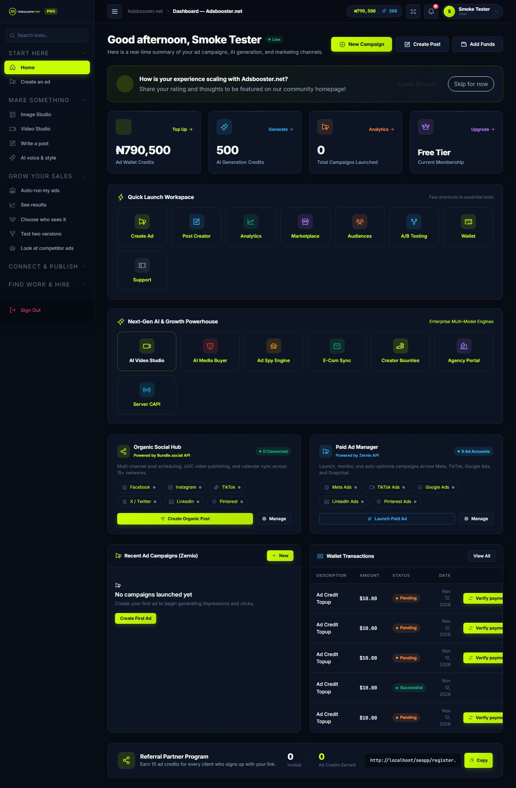

## 2. Connecting your accounts

This single page links every social network (for posting) and every ad network
(for paid ads).

1. Click **Connect** on a network.
2. A window from that network's own website opens — sign in and approve there.
   **Your password never touches this platform.**
3. You are returned to the page and the platform **checks with the gateway** that
   the connection really exists before it is stored. If the sign-in was not
   completed, you get an honest error instead of a fake "connected".
4. Disconnect any account at any time from the same page.

> Google Ads and the other ad networks connect the same way and power the Ad
> Launcher. LinkedIn/Pinterest ads also connect here.

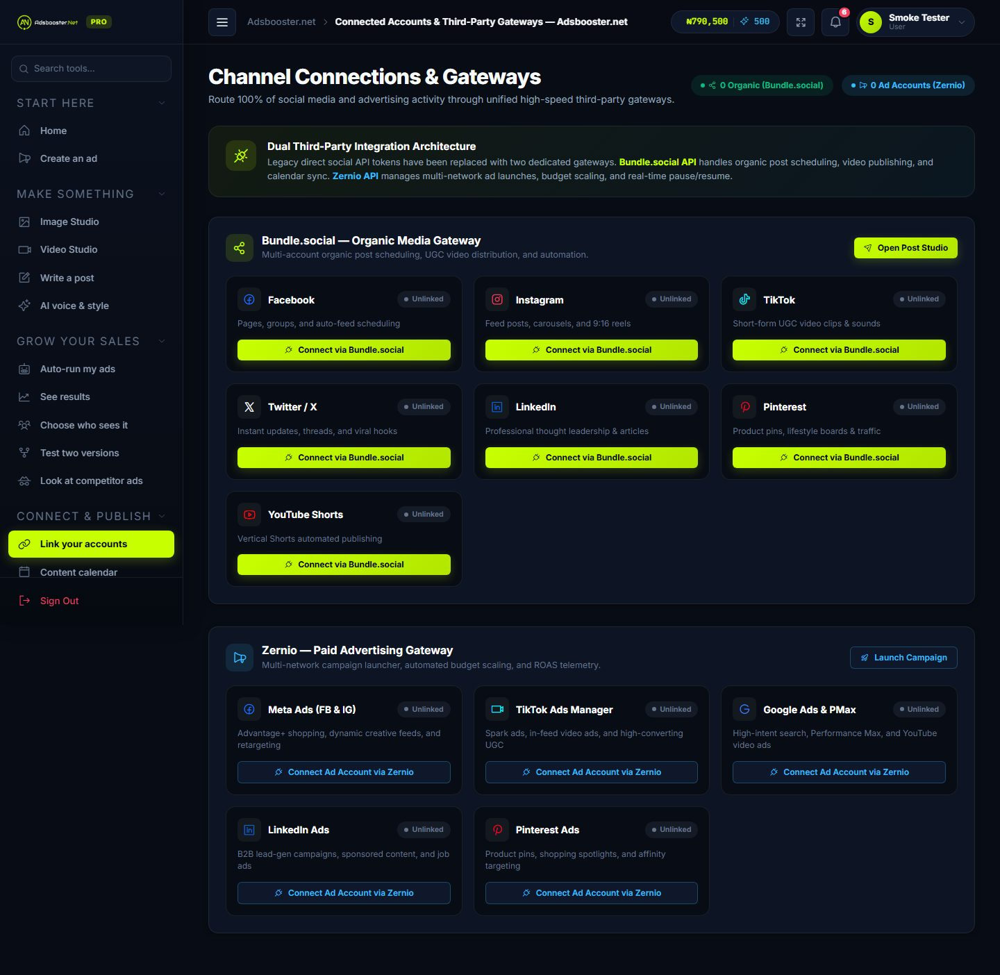

## 3. AI Photo Studio (UGC)

Creates photorealistic pictures of people holding your product — no camera, no
models, no designer.

1. Describe your product (or paste your website — the studio reads it).
2. Pick a **creator personality** (Gen-Z creator, fitness athlete, tech reviewer…),
   a **shooting style** (selfie hold, unboxing, kitchen scene, flat lay…) and a
   **size** (square for feed, vertical for Reels/TikTok, wide for banners).
3. Click **Generate** — get the photo plus ready-made ad copy.
4. Use the built-in editor: filters, badges ("BEST SELLER", "50% OFF"…), headline
   text.
5. **Download** it, or click **Create Post** to send it straight into the Post
   Creator.
6. Not happy? **Regenerate variations** keeps the concept, changes the shot.

> Works **without any API key** using the built-in free engine; a Gemini key
> upgrades it to the premium engine.

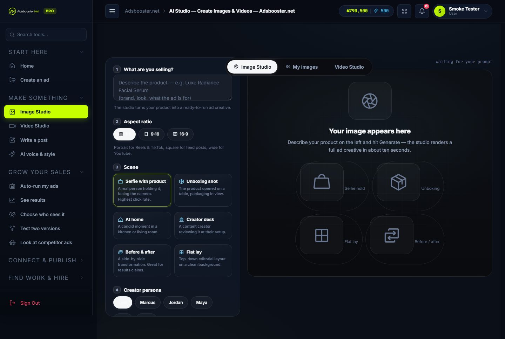

## 4. AI Video Studio

Turns a short script into a real video file.

1. Write your script (or let the AI write it from your product).
2. Choose a creator avatar, a caption style, a duration (10–120 s) and a size
   (vertical 9:16, square, wide 16:9).
3. Click **Render** — AI paints each scene, and the video is assembled with camera
   zoom, captions, a beat and a voice-over.
4. In the **library** each video can be:
   - **Edited** — change the script/scenes and re-render in place,
   - **Regenerated** — same script, brand-new scenes,
   - **Downloaded** — one click, standard MP4,
   - **Run as an ad** — jumps into the Ad Launcher with the video attached,
   - **Posted** — jumps into the Post Creator.

> The default rendering route is completely free and needs no key. Cloud render
> engines activate automatically when their keys are present, and always fall back
> to the built-in compositor — a render never fails half-way.

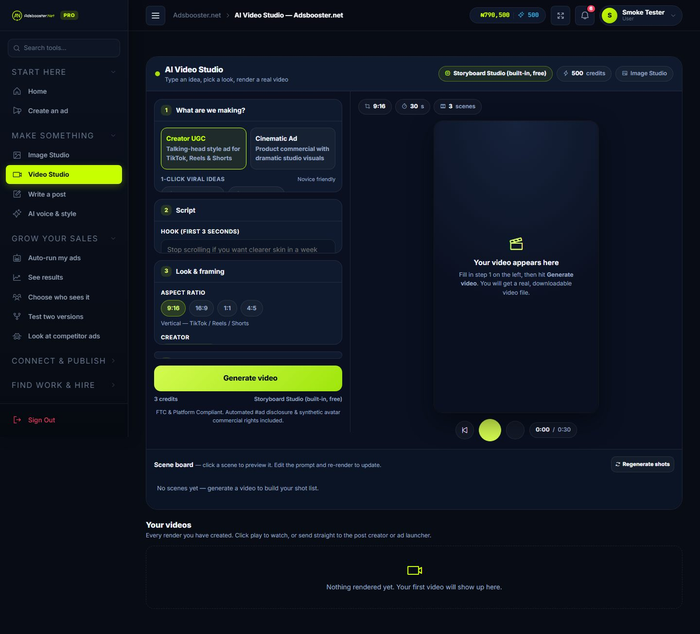

## 5. Post Creator & publishing

Publish to every connected network from one screen.

1. Write your text once.
2. Attach photos/videos (yours or freshly generated in the studios).
3. Tick the networks to publish to — each shows a live preview.
4. Choose **Send now** or **Schedule** (pick date & time), optionally add a first
   comment.
5. Done — you are returned to the calendar where the post appears.

Posts always go out **on time** because the background worker handles the waiting
(see [installation.md — Part 4](installation.md#part-4--the-cron-jobs-what-makes-posting--ads-actually-run)).
If a network rejects a post, the exact reason is shown on the post — nothing is
hidden.

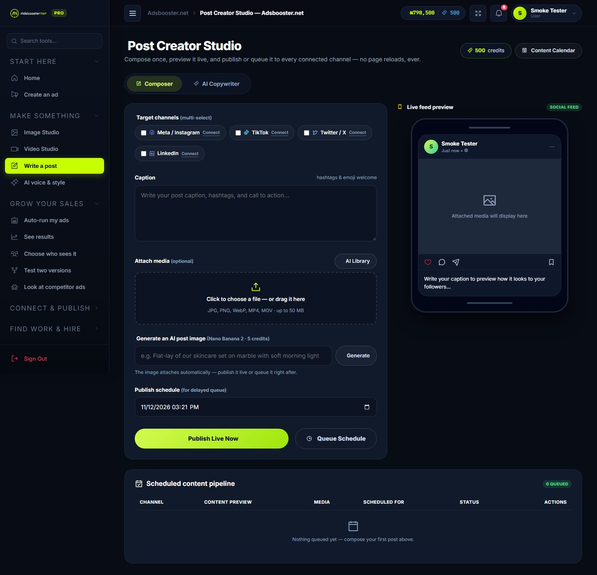

## 6. Content Calendar & reminders

Your whole publishing month on one screen.

- See every planned and published post by day.
- **Move a post** to another day/time, edit or cancel it.
- Add **private notes** to any day.
- Set how many **email reminders** you want before a post goes out (0–5): up to
  7 days before, then 1 day, 3 hours, 1 hour and 15 minutes before — automatically
  and only once each.

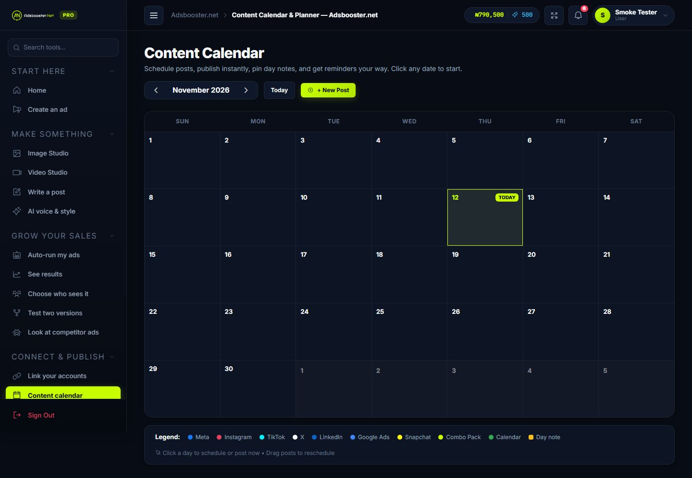

## 7. Comments & post results

After a post goes live:

- Read incoming comments and **reply from inside the platform** (no need to open
  the networks).
- See the numbers for every post: likes, comments, shares, views, reach.

## 8. Ad Launcher (paid campaigns)

Turn any creative into a paid ad on Meta, TikTok, Google, LinkedIn, Pinterest or
Reddit.

1. Pick your connected **ad account**.
2. Choose the **goal** (traffic, engagement, awareness, video views — the valid
   options for each network are handled for you).
3. Set the **daily budget**.
4. Write the **headline** and **ad text**; attach an image or video.
5. Choose the **audience**: age range, countries, interests (the platform resolves
   your words into the exact audience codes each network understands).
6. Click **Launch**. The campaign goes live on the network and appears in your
   Campaign Manager.

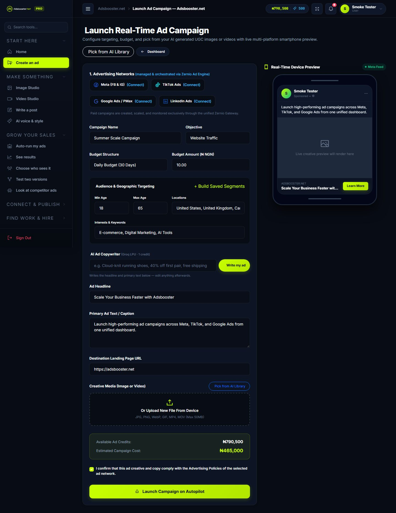

## 9. Campaign Manager

Every campaign on one screen.

- **Pause / Resume** with one click — the change is applied on the network and
  confirmed before your screen updates.
- **Scale the budget** up or down at any time (daily or lifetime).
- Real spend and result numbers are pulled in automatically every hour by the
  background worker.

## 10. Competitor Ad Spy

See which ads your competitors run right now, study their hooks and creatives, and
reuse what works as inspiration for your own studios and campaigns.

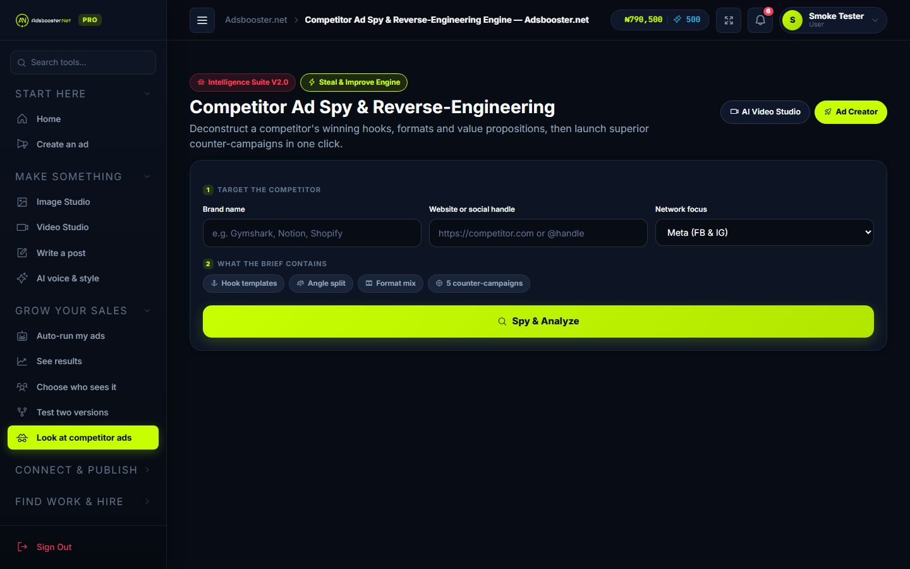

## 11. Audience Builder

1. Choose the network and the demographic rules (age, countries, languages…).
2. Add interests and behaviours — the platform searches each network's audience
   library for you.
3. Save the audience and reuse it in the Ad Launcher with one click.
4. **AI lookalikes**: upload a list of your best customers and get a matching
   "people like them" audience.

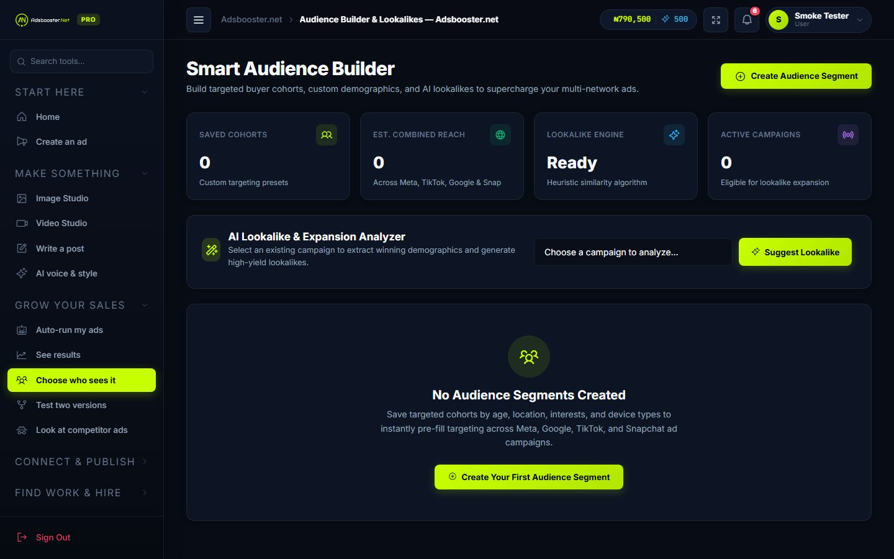

## 12. A/B Test Studio

1. Create a test with two (or more) creative variants.
2. The platform splits the traffic, measures both fairly, and when the sample is
   big enough **declares a winner**.
3. The winner's budget is increased automatically and the loser is reduced — every
   hour by the background worker, with the decision recorded so you can audit it.

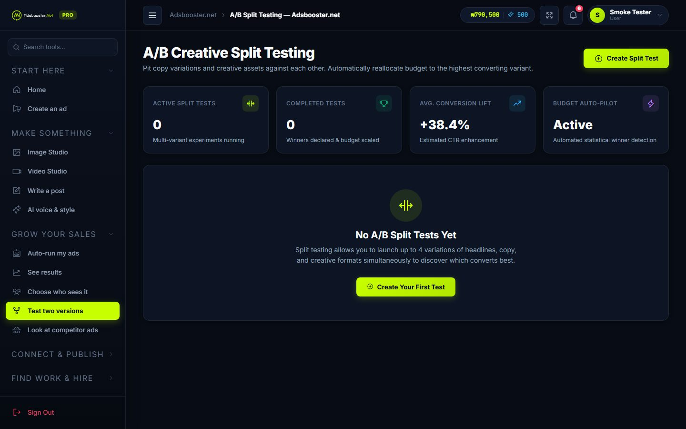

## 13. Anti-burn Auto-Pilot

Safety rules that guard your ad spend. Define rules like "pause if spend exceeds X
with zero results" — the background worker evaluates them continuously and pauses
burning campaigns on the network before they drain the budget. Every action is
logged with the reason.

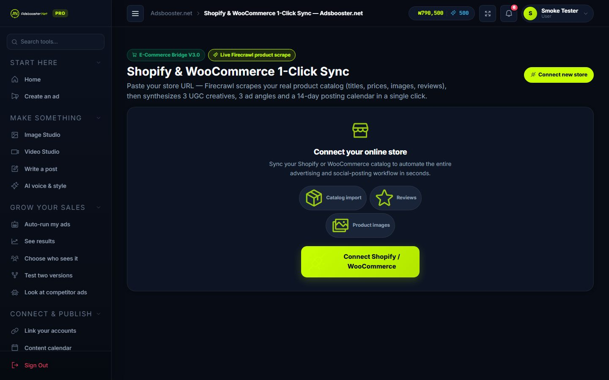

## 14. Store Import

1. Paste your **Shopify or WooCommerce** store address.
2. The platform imports your products (names, prices, photos, descriptions).
3. It builds ready-to-run **campaign packs** — headline, ad text and creative per
   product — which you can launch from the Ad Launcher in one click.

## 15. Business Directory

A verified directory of businesses and products. Sellers get verified badges;
buyers reach them instantly via **WhatsApp** or a **phone call** button. Filter by
category and location. The best listings are showcased on the homepage.

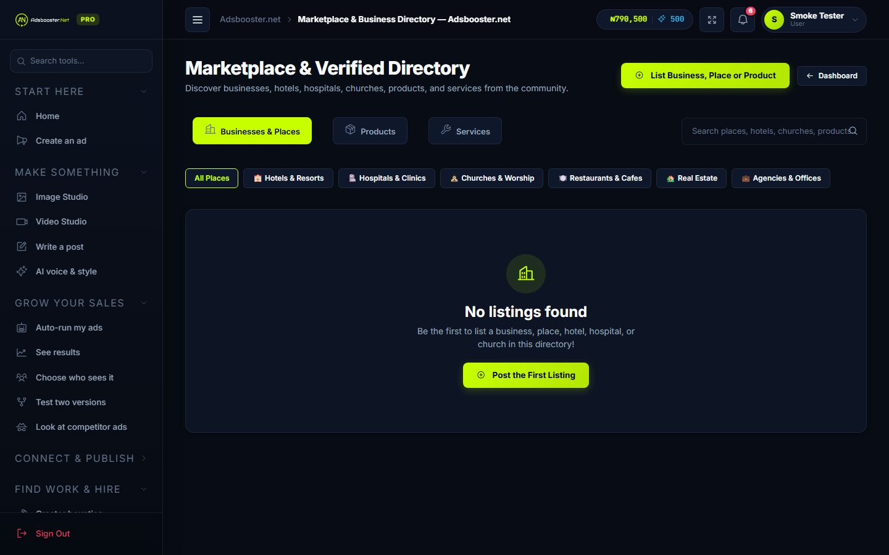

## 16. Talent Marketplace & P2P Chat

- Post or browse **jobs, contracts and bounties** for media buyers, creators,
  copywriters and performance marketers — filter by type, workplace and budget.
- **Chat directly** with any member; propose structured **deals** (agreed amount,
  milestones, deliverables) that both sides can track.
- Safety tools: report, block, and admin moderation.

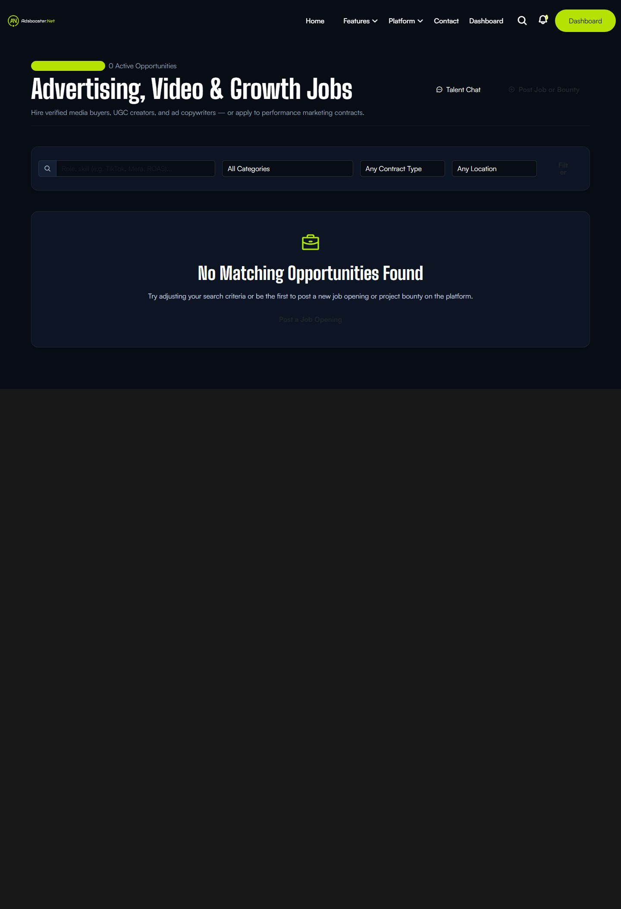

## 17. Referral Programme

1. On the Referrals page, copy your **personal invite link** and share it.
2. Your friend registers through it and gets a welcome bonus.
3. When your friend **pays** for a plan or credit pack, your reward is credited
   **automatically** — no admin approval needed, and it can never be paid twice for
   the same person.
4. Track everything (partners, earnings, pending) on the page.

Full details: [referrals.md](referrals.md).

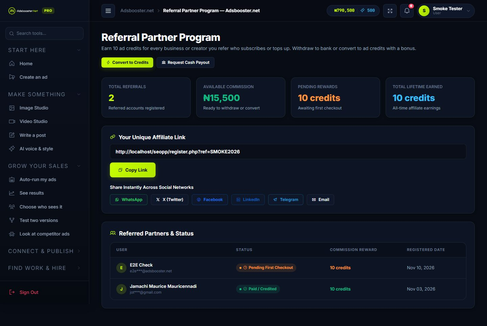

## 18. Plans, payments & billing

- Choose a **plan** or buy **credit packs** on the pricing page.
- Pay with **Paystack** or **Flutterwave** (card, bank, mobile money).
- Every payment is **verified with the payment company before anything is
  credited** — by callback, by webhook, or by an admin clicking Verify. Nothing is
  credited on trust.
- Members see wallet balance, history and **PDF invoices**.

Full details: [payments-webhooks.md](payments-webhooks.md).

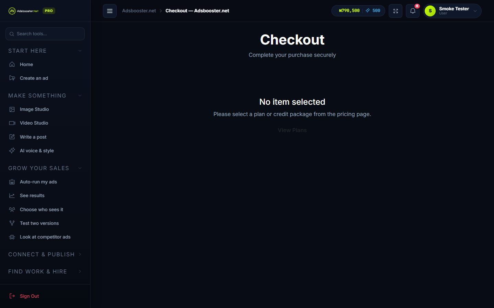
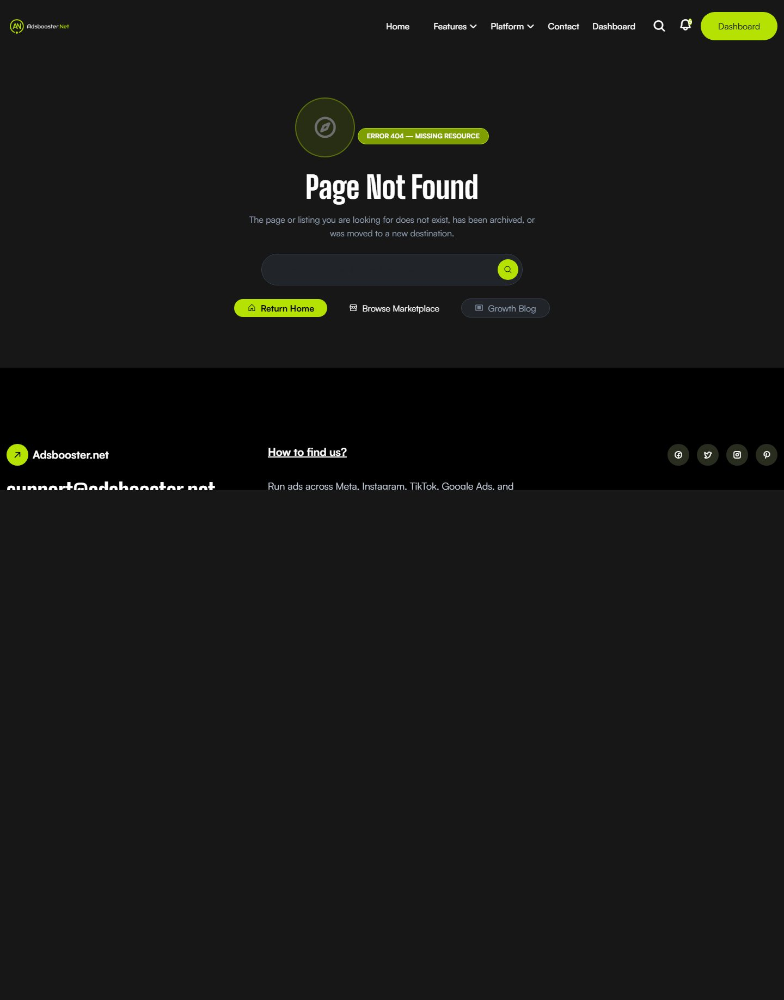

## 19. Two-factor login & account safety

- Enable 2FA with any authenticator app (Google Authenticator, Authy, 1Password…).
- **Email codes** are the fallback if you lose the app.
- Generate **8 single-use recovery codes** and store them safely.
- Admins must pass the second step every time, before the admin area opens.

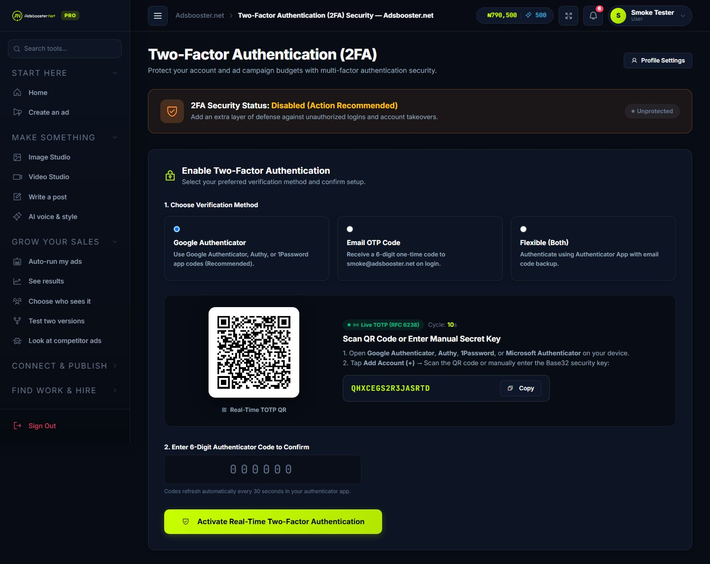

## 20. Developer API & webhooks

For teams that want other tools to talk to the platform:

- One **master key** controls everything; create it in the developer console.
- Ready-made client libraries for **JavaScript, Python and PHP**, plus full
  interactive documentation with copy-paste examples.
- Fair-use **rate limiting** with clear headers, and real-time **webhooks**
  (campaign status, post published, payment completed) signed so receivers can
  verify them, with a built-in one-click tester.

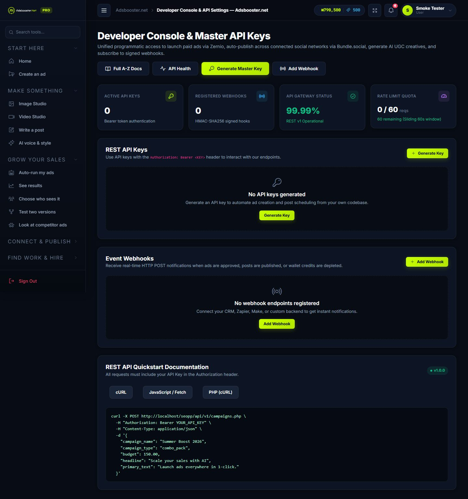

## 21. Admin control suite

Everything is managed from one sidebar: platform overview and health, users
(including "view as user" and credit adjustments), pricing plans, marketplace &
jobs & reviews moderation, campaign inspection, transactions with the payment
webhook URLs, referral programme controls, fraud watch, support tickets, SEO,
translations, policies and translations.

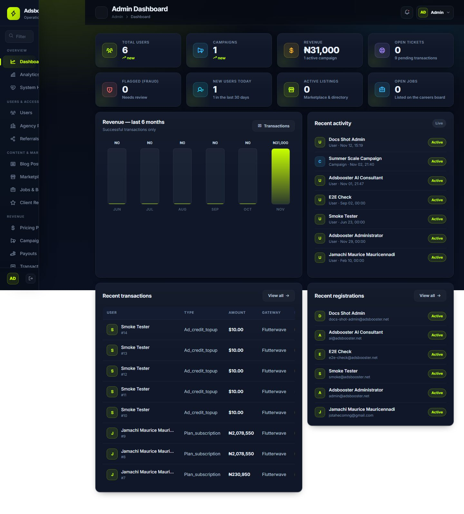
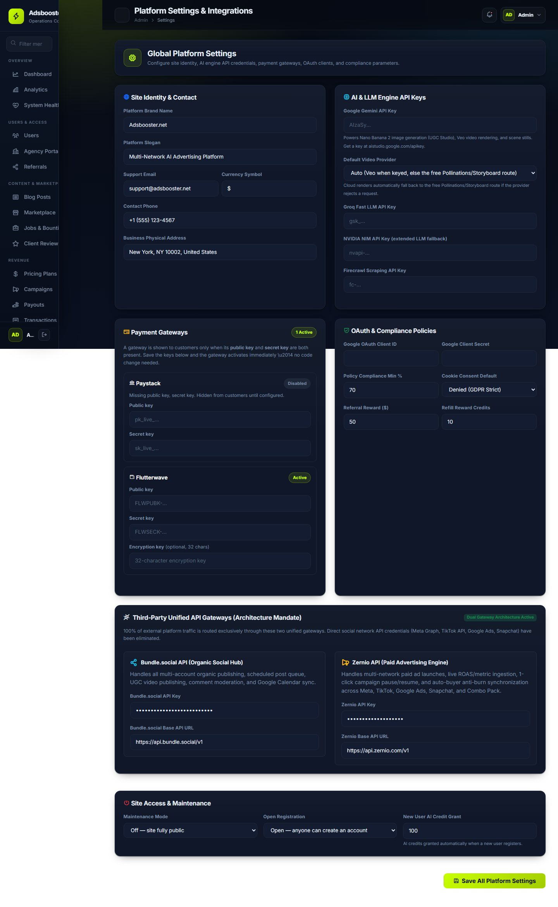

---

*© 2026 Adsbooster.net Engineering Team. All rights reserved.*
