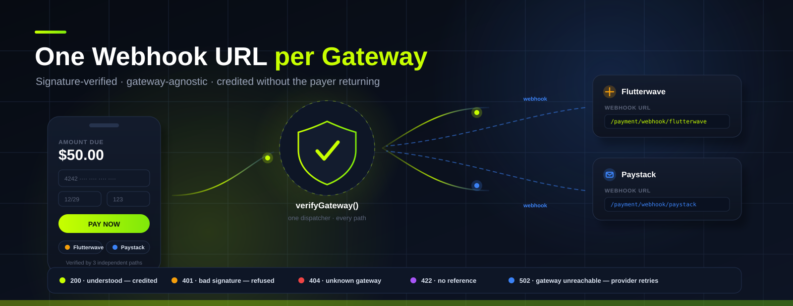

# Payments & Webhooks

<p align="center">
  
</p>

Adsbooster accepts card, USSD and bank-transfer payments through **Flutterwave** and
**Paystack**. Every gateway is verified through one gateway-agnostic code path, and every
gateway gets **its own inbound webhook URL** so the credits land even when the payer never
returns to the browser.

---

## 1. Webhook URLs — paste these into your gateway dashboard

| Gateway | Webhook URL | Where to paste it | Signature header |
|---|---|---|---|
| **Flutterwave** | `https://adsbooster.net/payment/webhook/flutterwave` | Dashboard → **Settings → Webhooks → Webhook URL** | `verif-hash` *(or `x-flw-signature`)* |
| **Paystack** | `https://adsbooster.net/payment/webhook/paystack` | Dashboard → **Settings → API Keys & Webhooks → URL** | `x-paystack-signature` |

> **Local development** — the URL follows the install path. On this machine the app runs at
> `http://localhost/seopp`, so the URLs are:
> `http://localhost/seopp/payment/webhook/flutterwave` and
> `http://localhost/seopp/payment/webhook/paystack`.
>
> Gateways cannot reach `localhost` — for real webhooks you need the public HTTPS URL.
> The live URLs are shown in **Admin → Transactions** with a copy button, so you never have
> to assemble them by hand.

The URLs are also available programmatically:

```php
require_once 'modules/payment_gateways.php';

PaymentGateways::webhookUrl('flutterwave');   // full absolute URL
PaymentGateways::webhookPath('flutterwave');  // payment/webhook/flutterwave
PaymentGateways::webhookUrls();               // every gateway + scheme + events + note
```

**Events to subscribe to**

- Flutterwave → `charge.completed`, `transfer.completed`
- Paystack → `charge.success`, `transfer.success`

---

## 2. How a payment is verified

There is exactly **one** verification dispatcher, so the checkout callback, the admin
*Verify* button and the webhook all behave identically:

```
PaymentProcessor::verifyGateway($gateway, $reference, $gatewayId = '')
```

| Step | What happens |
|---|---|
| 1 | The local transaction is found by `gateway_reference` or `reference`. |
| 2 | The gateway is called: Paystack `GET /transaction/verify/{ref}`, Flutterwave `GET /transactions/{flw_ref}/verify` (numeric id) or `GET /transactions/verify_by_reference?tx_ref=…`. |
| 3 | On success the matching local transaction is completed and the wallet is credited. |
| 4 | `completeTransaction()` also triggers the automatic referral reward (see [referrals.md](referrals.md)). |

### Failure handling

A failure is never silent — the caller always learns what happened:

- **`Payment verified but no local transaction was found`** → the local row is missing or
  the reference does not match. Run [`update-any-error.sql`](../update-any-error.sql) and
  re-verify.
- **Gateway unavailable / network error / 5xx** → the failure is marked *transient*. The
  webhook answers **HTTP 502** so the provider redelivers the event later.
- **Gateway answered and denied the payment** → the failure is *final*. The webhook
  answers **HTTP 200** (understood, no retry) and leaves the transaction pending for an
  admin decision.

---

## 3. The webhook endpoint

```
POST /payment/webhook/<gateway>
```

`payment-webhook.php` is the single endpoint; the gateway key is taken from the clean URL
(routed by `.htaccess`). Responses are always JSON.

| HTTP code | Meaning |
|---|---|
| `200` | Understood. `status: true` means the credits were granted; `status: false` means the event was received but did not settle (see `message`). |
| `401` | Invalid or missing signature — the request was refused. |
| `404` | Unknown gateway. The response lists the gateways that are registered. |
| `422` | The payload contained no payment reference. |
| `500` | An unexpected processing error. |
| `502` | The gateway could not be reached to confirm. **The provider should retry.** |

Example response:

```json
{
  "status": true,
  "result": "successful",
  "message": "Payment verified and wallet credited successfully!",
  "gateway": "flutterwave",
  "reference": "1C5325BE76460FD8ABD153E7",
  "transaction": 42,
  "settled_by": "gateway_api",
  "retry": false
}
```

### Request flow

1. **Unknown gateway** → `404`.
2. **Signature check** → `401` when the signature is missing or wrong.
3. **Reference extraction** → `422` when the payload carries no reference.
4. **Delivery log** → written to `payment_webhook_events` (see the SQL file).
5. **Verification** → the gateway is asked to confirm; the local transaction is completed.
6. **Outcome persisted** → the transaction status and the delivery log are updated.

### Signature schemes

| Gateway | Header | Formula |
|---|---|---|
| Paystack | `x-paystack-signature` | `HMAC-SHA512(raw body, secret key)` |
| Flutterwave | `verif-hash` | `sha256(secret key)` — **static, does not cover the body** |
| Flutterwave | `x-flw-signature` | `HMAC-SHA256(raw body, secret key)` |
| Any new gateway | `x-adsbooster-signature` or `x-webhook-signature` | `HMAC-SHA256(raw body, secret)` |

A gateway with **no configured secret refuses every payload** — an unconfigured Paystack
account cannot be spoofed by sending an unsigned request.

> ⚠ **Flutterwave's `verif-hash` is a static value for the account.** It proves the sender
> knows the secret, but it does **not** authenticate the body. Any code that trusts the
> payload itself must therefore require a body-bound signature —
> `PaymentGateways::webhookSignatureCoversBody()` answers exactly that question.

---

## 4. The signed-payload fallback

If the gateway cannot be reached (network error, 5xx, unparseable answer) the money has
still moved, so a **signed** payload that explicitly reports success settles the local
pending transaction instead of silently dropping the event.

All four conditions must hold:

1. The failure was **transient** — a gateway that *answered* and denied the payment always
   wins. Crediting on a denial would pay out for a transaction that never settled.
2. The signature **covers the body** — `verif-hash` alone is not enough, because it is
   static and a captured delivery could be replayed with a forged body.
3. The payload **reports success explicitly** — `status` of `success`/`successful`/
   `completed`/`paid`, or an event name containing one of those words. Negated names
   (`unsuccessful`, `not_successful`, `reversed`, `refunded`, …) never qualify.
4. The payload **agrees with the local order** — amount (1-cent tolerance) and currency
   must match. This blocks a captured body being replayed onto a different order.

When the fallback fires, the response reports `"settled_by": "signed_payload"` and the
delivery log is tagged `[signed-payload fallback]`.

---

## 5. Database repair: `update-any-error.sql`

`update-any-error.sql` (project root) is the single idempotent repair file for the payment,
referral and webhook schema. Run it whenever a verification complains that a local
transaction is missing.

```bash
# MySQL client
mysql -u root adsbooster < update-any-error.sql

# or with the bundled runner
php database/apply_update_any_error.php

# preview the statements without executing them
php database/apply_update_any_error.php --dry-run
```

It is safe to run repeatedly — every statement is guarded, so a partial run can simply be
repeated. The file:

- backfills `referrals.referred_id` from the legacy `referred_user_id` mirror (and back),
- removes duplicate referral rows and adds the missing indexes,
- creates `payment_webhook_events` (the webhook delivery log) and `payout_requests`,
- seeds the referral settings into `site_settings`,
- ends with a verification `SELECT` that prints the current counts.

---

## 6. Admin tools

**Admin → Transactions** (`admin/transactions.php`)

- A panel at the top lists the webhook URL of every gateway with a **copy** button.
- **Verify** — a CSRF-protected POST that runs `verifyGateway()`. On success you are sent
  to the transaction list; on failure you are redirected to the **checkout page** with the
  order context and the error banner (and a pointer to `update-any-error.sql`).
- **Mark failed** — flags a pending transaction as failed without crediting anything.
- **Open on checkout** — jumps straight to the checkout page for that order.

**Admin → Referrals** (`admin/referrals.php`)

Programme settings, per-referral payout, bulk *Pay all pending*, reset and reject — see
[referrals.md](referrals.md).

---

## 7. Testing the webhook locally

```bash
# 1. Unsigned request → must be refused
curl -i -X POST http://localhost/seopp/payment/webhook/flutterwave \
     -H 'Content-Type: application/json' \
     -d '{"event":"charge.completed","data":{"tx_ref":"SMOKE-1","status":"successful"}}'
# → HTTP 401

# 2. Unknown gateway → must be refused
curl -i -X POST http://localhost/seopp/payment/webhook/nosuchgateway -d '{}'
# → HTTP 404

# 3. Signed request with a real reference → settles the transaction
#    (Flutterwave verif-hash = sha256 of the webhook secret)
VERIF=$(php -r 'echo hash("sha256", "YOUR_FLUTTERWAVE_SECRET");')
curl -i -X POST http://localhost/seopp/payment/webhook/flutterwave \
     -H "verif-hash: $VERIF" \
     -H 'Content-Type: application/json' \
     -d '{"event":"charge.completed","data":{"tx_ref":"REAL_REFERENCE","status":"successful"}}'
# → HTTP 200
```

The automated equivalents live in the test suite:

```bash
php -d extension=php_pdo_mysql.dll vendor/bin/phpunit --filter PaymentWebhook
```

---

## 8. Adding another gateway

1. Add the entry to `PaymentGateways::REGISTRY` with `webhook_path`, `webhook_scheme`,
   `webhook_events` and `webhook_note`.
2. Add the credentials to `config/apikeys.php` (and the `webhook` slot for the webhook
   secret).
3. The generic scheme is inherited automatically: the endpoint verifies
   `x-adsbooster-signature` / `x-webhook-signature` (HMAC-SHA256 over the raw body), and
   `verifyGenericGateway()` calls `GET {base}/verify/{reference}` expecting
   `{status: "success", data: {...}}`.
4. The webhook URL is generated from the registry — no extra wiring.

---

## 9. Related files

| File | Purpose |
|---|---|
| `payment-webhook.php` | The inbound webhook endpoint. |
| `modules/payment_gateways.php` | Registry, webhook URLs, signature verification. |
| `modules/payment_webhook.php` | Webhook decision logic (success detection, replay guard). |
| `modules/payments.php` | `PaymentProcessor` — verification, completion, wallet crediting. |
| `modules/referral_service.php` | Automatic referral rewards triggered by a completed payment. |
| `payment-verify.php` | Checkout callback + admin verify redirect handling. |
| `update-any-error.sql` | Idempotent schema repair file. |
| `database/apply_update_any_error.php` | CLI runner for the repair file. |

---

## Source code

| Resource | URL |
|---|---|
| Project repository | <https://github.com/FushionHub/adbooster_net> |
| Official JS/TS SDK | <https://github.com/FushionHub/adsbooster-js-sdk> |
